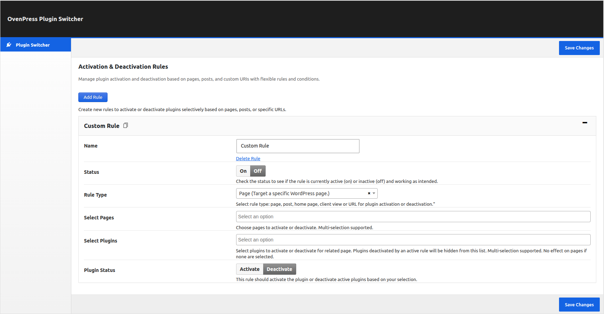

# OvenPress Plugin Switcher

**Contributors:** [WPOven](https://www.wpoven.com/)  
**Requires at least:** 6.6
**Tested up to:** 7.0
**Stable tag:** 1.1.6
**License:** GPLv2 or later  
**License URI:** [http://www.gnu.org/licenses/gpl-2.0.html](http://www.gnu.org/licenses/gpl-2.0.html)

## Description

OvenPress Plugin Switcher is a powerful WordPress management tool that enables users to easily activate or deactivate plugins on specific pages or posts, optimizing site performance and functionality while streamlining plugin configurations for a customized website experience.

## Screenshots

## Installation

1. **Download the Plugin:**

   - To get the latest version of OvenPress Plugin Switcher, you can either:
     - [Visit OvenPress's website](https://www.wpoven.com/plugins/ovenpress-plugin-switcher) to learn more about the plugin.
     - Download directly from the GitHub repository: [Download](https://github.com/baseapp/ovenpress_pluginswitcher/releases/download/1.1.6/ovenpress-plugin-switcher.zip).

2. **Upload the Plugin:**

   - Log in to your WordPress admin dashboard.
   - Navigate to **Plugins > Add New**.
   - Click on the **Upload Plugin** button.
   - Choose the downloaded ZIP file and click **Install Now**.

3. **Activate the Plugin:**

   - After installation, click on the **Activate Plugin** link.

4. **Configure Plugin Settings:**

   - Once activated, go to **Plugin Switcher Settings > OvenPress Plugin Switcher** in the WordPress admin menu.
   - Configure the plugin settings as per your requirements.

5. **Usage:**

   - To activate or deactivate plugins on specific pages or posts, follow the instructions in the plugin settings.

6. **Regular Updates:**
   - Keep the plugin updated for the latest features and security improvements. You can update the plugin through the **Plugins** section in your WordPress admin dashboard.

## Frequently Asked Questions

### 1. What Is OvenPress Plugin Switcher?

OvenPress Plugin Switcher is a WordPress plugin management tool that enables website owners to choose which plugins to activate or deactivate on specific pages or posts.

### 2. How do I activate & deactivate a WordPress plugin on a specific page or post?

To activate & deactivate a WordPress plugin on a specific page or post, you can use OvenPress Plugin Switcher. This plugin allows you to activate & deactivate any plugin, including WordPress core plugins, on a specific page or post or using a custom URL.

### 3. Can I activate & deactivate plugins for multiple pages or posts at once?

Yes, you can select multiple pages or posts to activate & deactivate a plugin.

### 4. Can OvenPress Plugin Switcher activate & deactivate multiple plugins at once?

Yes, OvenPress Plugin Switcher allows you to activate & deactivate multiple plugins simultaneously, saving you time and effort.

### 5. How can I disable WordPress plugins by custom URL?

You can activate & deactivate a plugin via a custom URL. For example, consider that you are using the WooCommerce Plugin. You likely don't need to load the WooCommerce CSS/JS files on contact pages. To do this:

1. Enable status -> On
2. Rule Type -> URL or Page or Post
3. Select Plugins -> WooCommerce
4. Plugin Status -> Activate/Deactivate
5. Save changes.

### 6. Is it safe to disable WordPress plugins?

Yes, it is safe to activate & deactivate WordPress plugins. However, you should always make a backup of your website before activating & deactivating any plugins.

### 7. Can I disable a plugin on my staging site?

Yes, you can activate & deactivate a plugin on your staging site. This can be helpful if you want to test how your website performs without a particular plugin.

### 8. How do I disable a plugin using OvenPress Plugin Switcher?

To activate & deactivate a plugin using OvenPress Plugin Switcher, go to the OvenPress Plugin Switcher settings page and select the "Status, Rule Type, Select Plugins, Plugin Status" option for the plugin you want to activate or deactivate.

## Changelog

### 1.1.6 

- Renamed the plugin branding from WPOven to OvenPress.

### 1.1.5 

- Added compatibility with PHP 8.4.18 and resolved deprecated warnings.

### 1.1.4

- Added front-end specific plugin activation/deactivation control.

### 1.1.3

- Prevent PHP warning for post match.

### 1.1.2

- Added support for defining post_match rules using POST key-value string format (e.g., key=value).

### 1.1.1

- Prevent the plugin switcher from running on the frontend to improve page load performance.

### 1.1.0

- Prevent deactivation of OvenPress Plugin Switcher.
- Improved rule matching logic.

### 1.0.0

- Initial release with options to activate or deactivate plugins on specific pages or posts.

## Upgrade Notice

- This release introduces the OvenPress brand, replacing the previous WPOven branding.
